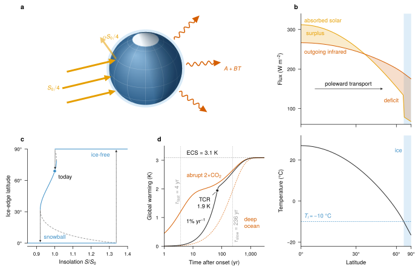

# Earth's energy balance and the ice-albedo feedback

*Climate science.* Where the planet gains and loses energy, why its ice edge can jump to a snowball state and back, and how fast the surface warms after CO2 doubles: a diffusive energy-balance model and a two-layer ocean, solved in the script.



**What it shows of FigWorks.** A VecView globe with upright VecTeX labels beside stacked and single Matplotlib panels, with one colour each for sunlight, infrared, and ice carried from the 3D scene into every plot.

**Requires** VecView and TeX.

```bash
python examples/climate_energy_balance.py
```

[Python source](https://github.com/maiani/figworks/blob/main/examples/climate_energy_balance.py) · [SVG](../images/gallery-climate_energy_balance.svg)

## Preflight

Recorded by `python examples/gallery.py`; findings are for review, not a certification.

- `small-script`: 15
- `small-text`: 28

Not checked:

- Font/stroke sizes, visibility, raster resolution, and bounds of use instances.
- Painted bounds for paths, text, use, markers, and clipped or filtered content.
