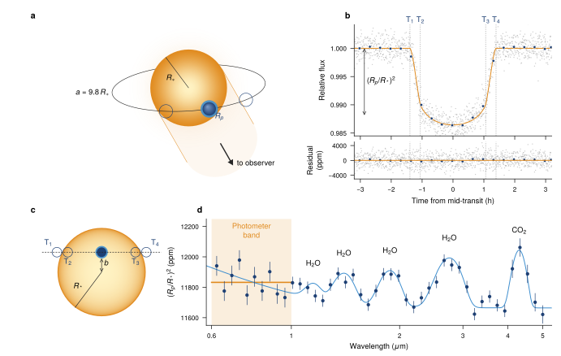

# A transiting hot Jupiter

*Astrophysics.* The transit geometry, a limb-darkened light curve with residuals, and the planet's transmission spectrum.



**What it shows of FigWorks.** A VecView star system with pinned VecTeX labels beside stacked, aligned Matplotlib panels.

**Requires** VecView and TeX.

```bash
python examples/exoplanet_transit.py
```

[Python source](https://github.com/maiani/figworks/blob/main/examples/exoplanet_transit.py) · [SVG](../images/gallery-exoplanet_transit.svg)

## Preflight

Recorded by `python examples/gallery.py`; findings are for review, not a certification.

- `small-script`: 20
- `small-text`: 24

Not checked:

- Font/stroke sizes, visibility, raster resolution, and bounds of use instances.
- Painted bounds for paths, text, use, markers, and clipped or filtered content.
