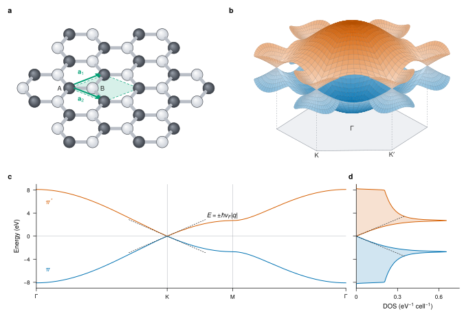
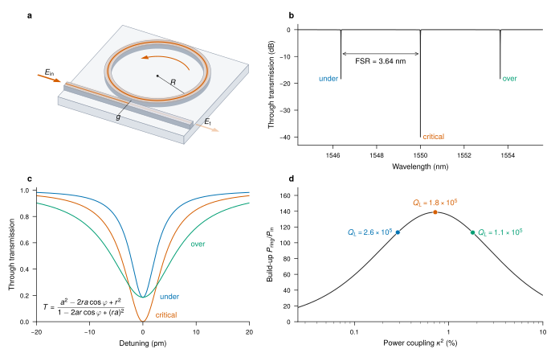
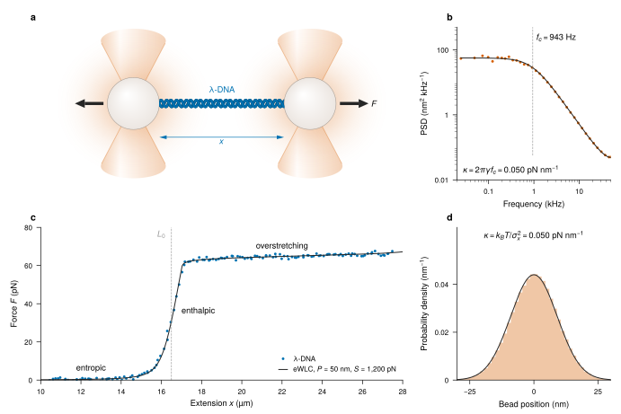
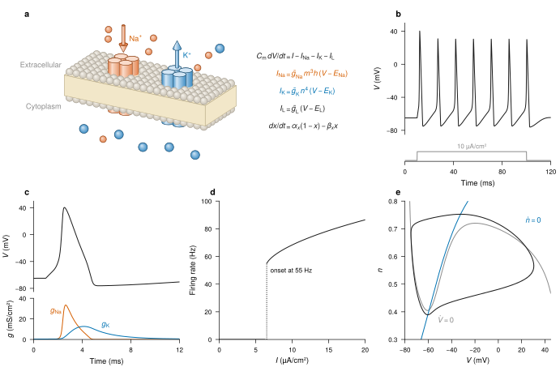
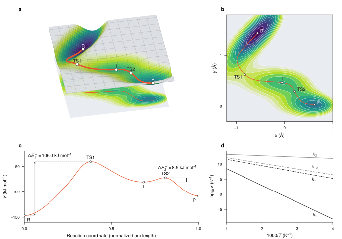

# Gallery

Figures from across the sciences, each built by one self-contained script at its printed size: 183 mm wide, the two-column width of Nature. Every one pairs a schematic with quantitative panels computed from the model it illustrates, and every element of the SVG stays editable.

Data shown as measurements are simulated, with fixed seeds; each script says which.

<div class="grid cards" markdown>

-   **[A transmon, from device to spectrum](transmon_figure.md)**

    [](transmon_figure.md)

    *Superconducting qubits.* The device, its circuit and Hamiltonian, the cosine potential with its lowest levels, and the charge dispersion that vanishes as E_J/E_C grows.

-   **[Dirac electrons in graphene](graphene_bands.md)**

    [](graphene_bands.md)

    *Condensed matter.* The honeycomb lattice, its two tight-binding bands touching at the Dirac points, the band structure along high-symmetry lines, and the density of states.

-   **[A microring resonator](microring_resonator.md)**

    [](microring_resonator.md)

    *Photonics.* A ring coupled to a bus waveguide, its comb of resonances, and how the coupling regime shapes each dip.

-   **[Stretching DNA with optical tweezers](optical_tweezers.md)**

    [](optical_tweezers.md)

    *Biophysics.* A DNA molecule held between two trapped beads, its worm-like-chain force-extension curve, and the Brownian motion that calibrates the trap.

-   **[The action potential](hodgkin_huxley.md)**

    [](hodgkin_huxley.md)

    *Neuroscience.* Sodium and potassium channels in the membrane, and the Hodgkin-Huxley model's spikes, conductances, and firing threshold.

-   **[A transiting hot Jupiter](exoplanet_transit.md)**

    [](exoplanet_transit.md)

    *Astrophysics.* The transit geometry, a limb-darkened light curve with residuals, and the planet's transmission spectrum.

-   **[Reaction paths on a potential-energy surface](energy_landscape.md)**

    [](energy_landscape.md)

    *Chemistry.* The Müller-Brown surface in 3D, its minimum-energy path, and the barriers along the reaction coordinate.

</div>

## Rebuild

```bash
python examples/gallery.py         # build and audit every figure
python examples/gallery.py --docs  # also refresh these pages
```

The build needs VecView, VecWire, and TeX, and fails rather than skip a figure. It records each SVG's hash and preflight findings in `examples/out/gallery-report.json`.
