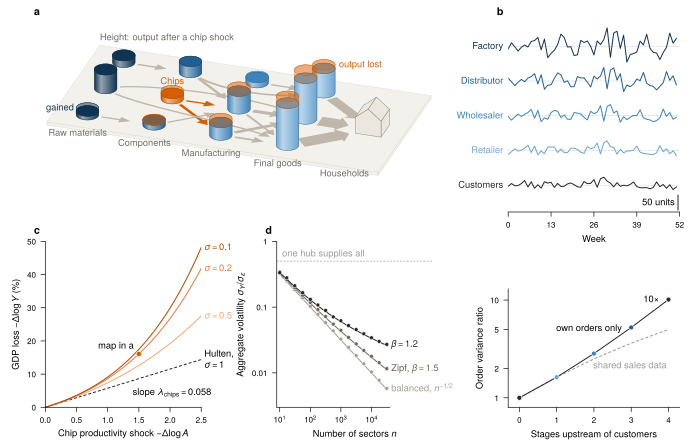

# Shocks in a production network

*Economics.* What a collapse of chip productivity does to every sector of a CES input-output economy, why complementarity breaks Hulten's theorem for large shocks, how orders swell up a supply chain, and why hub suppliers stop shocks averaging out.



**What it shows of FigWorks.** A VecView map of the economy, with towers sized by the equilibrium the script solves and flows as flat arrows on the floor, beside stacked and single Matplotlib panels; the shock and each tier keep one colour from map to plot.

**Requires** VecView and TeX.

```bash
python examples/production_network.py
```

[Python source](https://github.com/maiani/figworks/blob/main/examples/production_network.py) · [SVG](../images/gallery-production_network.svg)

## Preflight

Recorded by `python examples/gallery.py`; findings are for review, not a certification.

- `small-script`: 11
- `small-text`: 41

Not checked:

- Font/stroke sizes, visibility, raster resolution, and bounds of use instances.
- Painted bounds for paths, text, use, markers, and clipped or filtered content.
