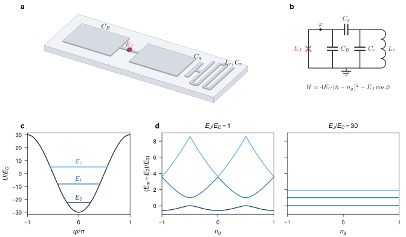

# A transmon, from device to spectrum

*Superconducting qubits.* The device, its circuit and Hamiltonian, the cosine potential with its lowest levels, and the charge dispersion that vanishes as E_J/E_C grows.



**What it shows of FigWorks.** All four producers in one figure: a VecView device, a VecWire circuit, VecTeX labels pinned into both, and Matplotlib panels aligned on the grid.

**Requires** VecView, VecWire, and TeX.

```bash
python examples/transmon_figure.py
```

[Python source](https://github.com/maiani/figworks/blob/main/examples/transmon_figure.py) · [SVG](../images/gallery-transmon_figure.svg)

## Preflight

Recorded by `python examples/gallery.py`; findings are for review, not a certification.

- `small-script`: 14

Not checked:

- Font/stroke sizes, visibility, raster resolution, and bounds of use instances.
- Painted bounds for paths, text, use, markers, and clipped or filtered content.
