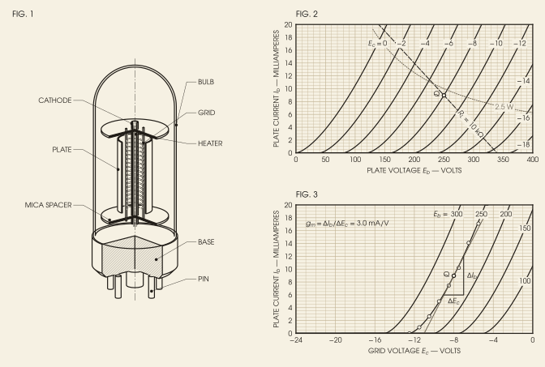

# A vacuum triode, from the drafting table

*Electronics.* A plate in the manner of a mid-century tube manual: the electrode assembly with a quarter cut away, the plate characteristics on graph paper with a load line, and the transconductance constructed on the mutual characteristics, all from Child's law.



**What it shows of FigWorks.** A VecView scene of solids turned on a lathe and inked as a technical drawing, beside Matplotlib graph paper, in a style of its own (vintage_style.md) that sets the lettering, the FIG. 1 panel labels, and the drafting arrowheads.

**Requires** VecView 0.5 or later.

```bash
python examples/vacuum_triode.py
```

[Python source](https://github.com/maiani/figworks/blob/main/examples/vacuum_triode.py) · [SVG](../images/gallery-vacuum_triode.svg)

## Preflight

Recorded by `python examples/gallery.py`; findings are for review, not a certification.

- `small-script`: 12

Not checked:

- Font/stroke sizes, visibility, raster resolution, and bounds of use instances.
- Fonts, sizes, raster resolution, and bounds inside patterns and markers.
- Painted bounds for paths, text, use, markers, and clipped or filtered content.
